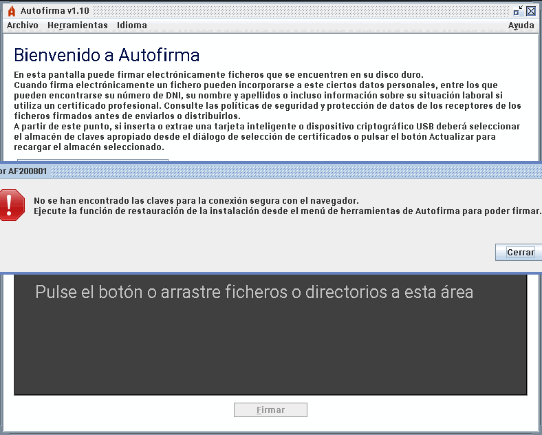
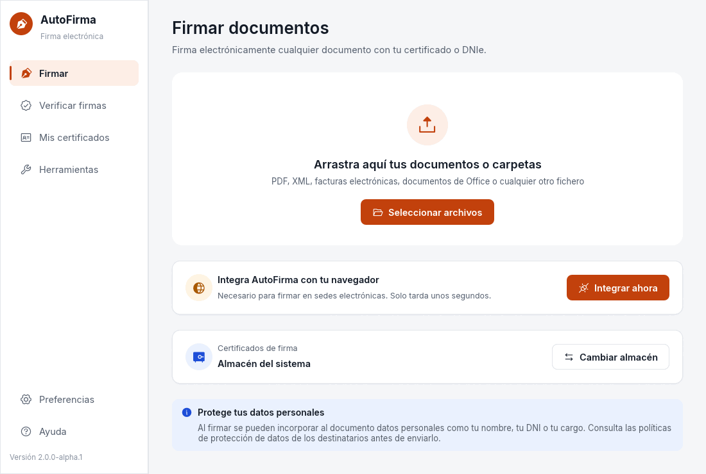
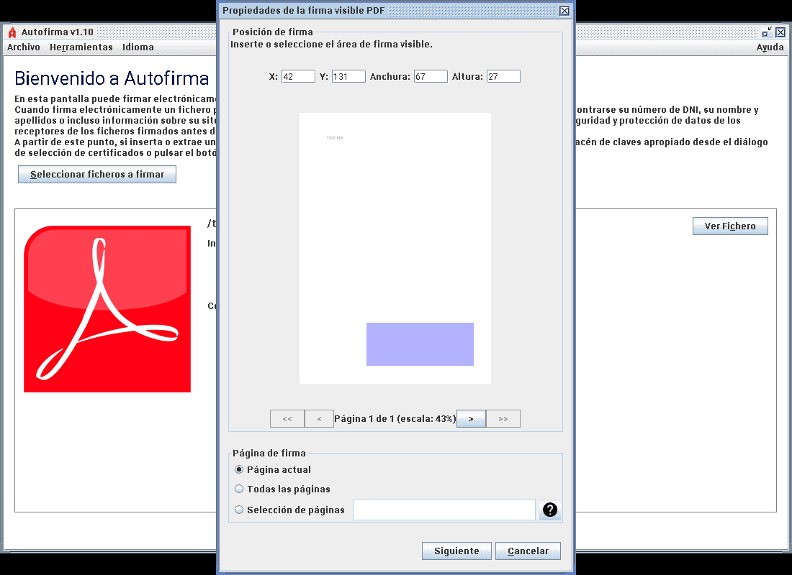
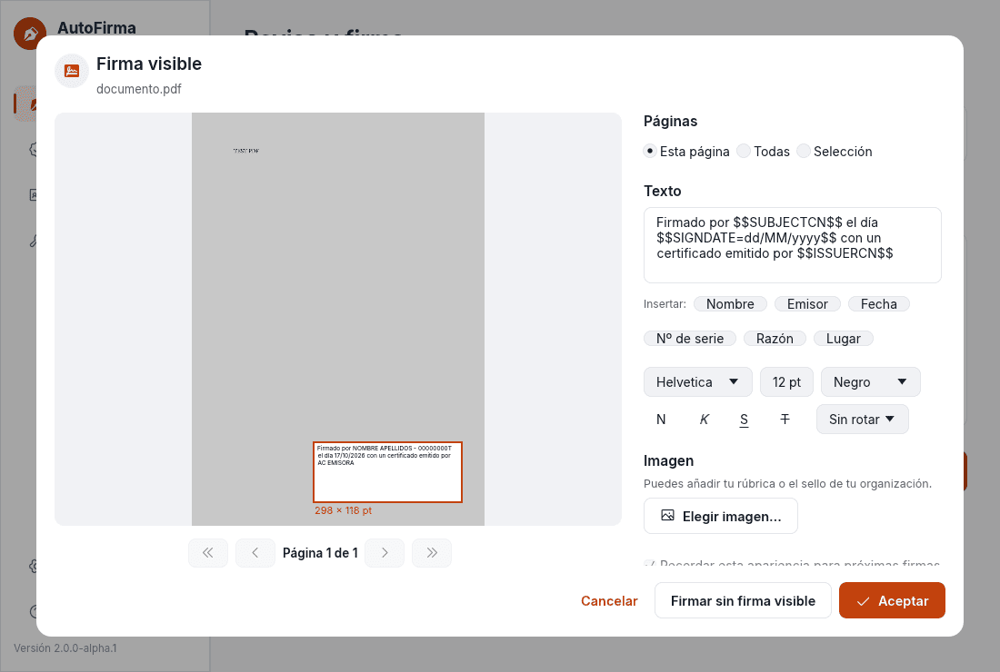
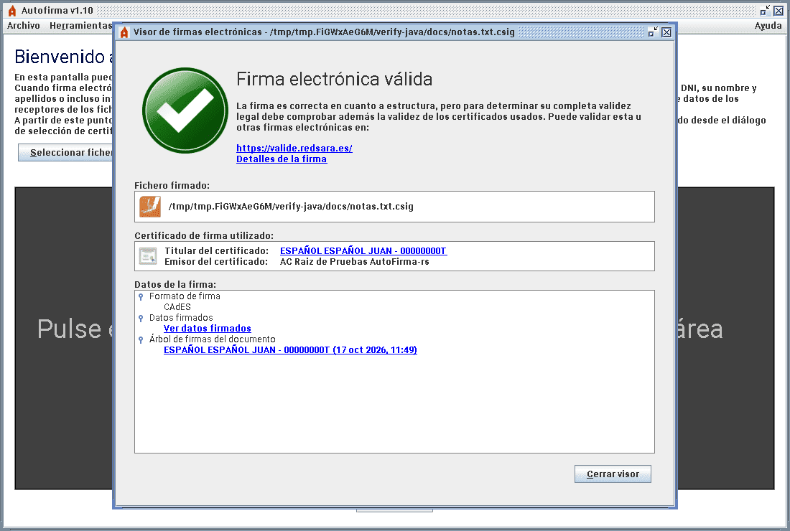
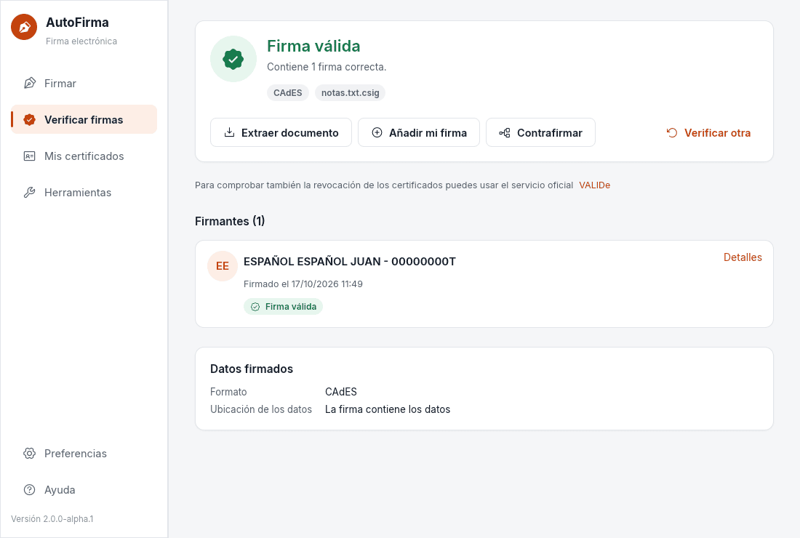

# AutoFirma-rs frente a AutoFirma Java

Comparación medida de las dos versiones en la misma máquina, y diferencias de uso.
Los scripts para repetirla están en [`tools/bench/`](../tools/bench/).

## Rendimiento

Equipo: Intel Core i5-13500 (20 hilos), Linux, OpenJDK 21 para la versión Java
(`autofirma.jar` 1.10 compilado del código de este repositorio) y el binario *release* de
AutoFirma-rs 2.0.0-alpha.1 para x86_64 con glibc 2.28.

### Línea de comandos

`AFIRMA_JAR=… tools/bench/compare_java.sh <autofirma-rs> 5`: mismas órdenes y mismos
ficheros; antes de medir se comprueba que cada operación termina bien en las dos versiones.
Mediana de 5 ejecuciones del tiempo total y de la memoria máxima (RSS) del proceso.

| Operación (mediana de 5) | AutoFirma Java (tiempo / RAM máx.) | AutoFirma-rs | Más rápido |
|---|---|---|---|
| Arranque (ayuda de la línea de comandos) | 1,76 s / 101 MB | < 0,01 s / 10 MB | × > 176 |
| Listar certificados de un PKCS#12 | 1,81 s / 106 MB | < 0,01 s / 12 MB | × > 181 |
| Firma CAdES de 20 MB | 3,56 s / 478 MB | 1,37 s / 66 MB | × 2,6 |
| Firma XAdES de un XML | 1,91 s / 151 MB | < 0,01 s / 14 MB | × > 191 |
| Firma PAdES de un PDF de 2,5 MB | 2,00 s / 193 MB | 0,02 s / 27 MB | × 100 |
| Verificar la firma CAdES | 1,91 s / 137 MB | < 0,01 s / 11 MB | × > 191 |

`/usr/bin/time` mide en centésimas de segundo: «< 0,01 s» indica que la operación tarda menos.
La firma PAdES resultante es válida en `pdfsig`. La mayor parte del tiempo de Java es el
arranque de la máquina virtual; en operaciones con muchos datos (CAdES de 20 MB) la
diferencia baja a ×2,6 y la memoria, a una séptima parte.

### Interfaz gráfica

`tools/bench/gui_startup.sh`: tiempo hasta que la ventana principal es visible y memoria
tras 10 s, en un X virtual con renderizado por software (Mesa llvmpipe, que también
aumenta la memoria de AutoFirma-rs respecto a un equipo con GPU).

| | AutoFirma Java | AutoFirma-rs |
|---|---|---|
| Ventana principal visible (en caliente, 3 ejecuciones) | 0,54–0,61 s | 0,11–0,22 s |
| Primera ejecución tras arrancar el equipo (en frío) | 4,3 s | — |
| Memoria tras 10 s | 157–163 MB | 122 MB |

### Tamaño

| | AutoFirma Java | AutoFirma-rs |
|---|---|---|
| Programa | `autofirma.jar` de 53 MB, más una máquina virtual Java (incluida en los instaladores oficiales) | un ejecutable autónomo de 44–48 MB según el sistema (incluye el renderizador de PDF y las fuentes para PDF/A) |
| Paquetes | — | `.deb` 14 MB, `.rpm` 15 MB, AppImage 20 MB, ZIP de Windows 20 MB, MSI 45 MB |

## Primer arranque

Sin la integración con el navegador hecha (por ejemplo, la versión portable o un perfil de
usuario nuevo), AutoFirma Java abre una ventana de error que hay que cerrar y remite a un
menú; AutoFirma-rs muestra un aviso con un botón que lo resuelve en el momento.

| AutoFirma Java | AutoFirma-rs |
|---|---|
|  |  |

## Pasos por tarea

`AFIRMA_JAR=… tools/bench/ui_tasks.sh <autofirma-rs>` maneja las dos interfaces con xdotool en un
X virtual (Xvfb), cuenta lo que hay que hacer en cada tarea y, al terminar, comprueba el
resultado (firma válida y visible, preferencia guardada). Son las interacciones que necesita un
guion, no tiempos ni pruebas con personas, que no se han hecho.

Las dos parten de una ventana de 1100×740, un perfil nuevo con las mismas preferencias y los
mismos ficheros. Para firmar, el almacén por defecto es el PKCS#12 de pruebas; las dos piden su
contraseña (Java al arrancar, AutoFirma-rs al elegir el certificado), y esa es la entrada de
teclado de las tareas de firma. Los diálogos de ficheros se abren en la carpeta de los
documentos: el propio de Java y el del escritorio (portal GTK) en AutoFirma-rs. Elegir un
fichero cuesta dos clics en los dos (el fichero y «Abrir»), y elegir tres, tres (el primero, el
último con Mayús y «Abrir»).

| Tarea | | Clics | Teclado | Ventanas y diálogos | Al terminar |
|---|---|---|---|---|---|
| Firmar un PDF con firma visible | Java | 10 + 1 arrastre | 1 | 6 | ruta del fichero firmado |
| | AutoFirma-rs | 8 + 1 arrastre | 1 | 5 | ruta del fichero firmado |
| Firmar un PDF, un XML y un texto | Java | 8 | 1 | 5 | carpeta y nombre de cada firma |
| | AutoFirma-rs | 7 | 1 | 4 | carpeta de las firmas, con botón para abrirla |
| Verificar una firma CAdES y ver el firmante | Java | 4 | 0 | 2 | firmante, en un visor aparte |
| | AutoFirma-rs | 4 | 0 | 1 | firmante, en la misma ventana |
| Formato por defecto de «Resto de ficheros» | Java | 7 | 0 | 2 | sin aviso |
| | AutoFirma-rs | 5 + 1 desplazamiento | 0 | 0 | sin aviso |

«Ventanas y diálogos» cuenta las ventanas propias y las superpuestas a la principal, salvo las
de progreso. De dónde salen las diferencias:

- **PDF con firma visible**: Java pregunta dónde guardar y separa la firma visible en dos paneles
  (posición y apariencia). AutoFirma-rs muestra la apariencia en el mismo editor y, antes de
  firmar, enseña dónde guardará la firma («Guardar como: …/documento_signed.pdf», junto al
  original y con `(1)` si ya existe), con un enlace «Cambiar» que abre el diálogo de guardar;
  aceptar la propuesta no cuesta ningún clic.
- **Tres ficheros**: Java pide la carpeta de salida en cada firma múltiple. AutoFirma-rs guarda
  junto a cada original y lo indica antes de firmar («Carpeta de destino», con enlace para
  cambiarla); la pantalla final dice dónde quedaron y permite abrir la carpeta.
- **Verificar**: los mismos clics; Java abre el resultado en una ventana que luego hay que cerrar.
- **Preferencias**: en Java, menú, diálogo con pestañas, subdiálogo «Formatos de firma» y dos
  «Aceptar»; en AutoFirma-rs, la página «Preferencias» > «Firma» y «Guardar», aunque a 1100×740
  hay que desplazar la página hasta el grupo de formatos.

No se ha medido arrastrar ficheros a la ventana, que admiten las dos pero xdotool no simula de
forma fiable, ni el manejo solo con teclado. Tampoco el tiempo: el guion espera pausas fijas tras
cada paso, así que su duración no dice nada de la aplicación.

| AutoFirma Java | AutoFirma-rs |
|---|---|
|  |  |
|  |  |

## Diferencias de uso

| | AutoFirma Java | AutoFirma-rs |
|---|---|---|
| Firmar | un fichero o varios desde un diálogo; la firma visible se coloca en una vista previa de 75 ppp | arrastrar ficheros o carpetas, lista con el formato de cada uno, vista previa del PDF a resolución completa con la apariencia en tiempo real y marca de imagen en el mismo editor |
| Verificar | visor de firmas con árbol | página propia con estado global, firmantes, sellos de tiempo, política y certificado, extracción del documento, cofirma y contrafirma desde el resultado |
| Certificados | solo al firmar | página «Mis certificados»: ver, exportar, comprobar revocación (OCSP/CRL), almacén por defecto, tarjetas PKCS#11 |
| Petición desde la web | diálogos encadenados | una ventana compacta con la sede, el documento y el certificado |
| Integración | «Restaurar instalación» manual | diagnóstico con reparación de un clic y aviso automático si falta |
| Validación OCSP/CRL | complemento opcional; no verifica las respuestas | integrada, verificando firma, respondedor y vigencia |
| PDF/A con firma visible | conforme solo en PDF/A-1 | conforme en PDF/A-1, 2 y 3 (veraPDF) |
| Despliegue sin avisos del navegador | no configura directivas | directivas de Chrome, Edge y Firefox; `autofirma doctor` para comprobarlo |
| Temas y accesibilidad | aspecto del sistema; alto contraste de Windows | claro, oscuro y alto contraste propios, escalado y nombres accesibles (AccessKit) |
| Segunda ejecución | aviso «La aplicación ya se está ejecutando» | los ficheros se abren en la ventana existente |
